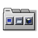

<p align="center">
  
</p>

<h1 align="center">Big WM Tabbed Dock</h1>

<p align="center">
  Dock horizontal com abas para o <b>Window Maker</b> (X11) e o <b>wlmaker</b> (Wayland),
  inspirado na prateleira do OPENSTEP 4.0 beta — e o seu controlador, um dockapp clássico no Dock.
  <br>Parte do <a href="https://github.com/big-windowmaker">Big WindowMaker</a>.
</p>

<p align="center">
  <a href="https://github.com/big-windowmaker/tabbed-dock/actions/workflows/ci.yml"></a>
  
</p>

## O que tem aqui

| Programa | O que faz |
|---|---|
| `big-wm-tabbed-dock` | O dock: abas (Geral, Desenvolvimento, Documentos, Temporário e as suas), aplicativos, pastas e arquivos, aplicativos abertos, lixeira. X11 (EWMH, forma da janela) e Wayland (layer-shell, foreign-toplevel). |
| `big-wm-tabbed-dock-dockapp` | O **controlador**, um ladrilho de 64 px no Dock do Window Maker (e, pelo XWayland, no do wlmaker), com botões no estilo OPENSTEP. |
| `big-wm-appicons` | Os appicons do Window Maker na sessão Wayland. |

### O controlador

```
┌──────────── ↑ ────────────┐   ↑ / ↓   borda: em cima / embaixo
│ ◀ │  tabbed-dock.svg  │ ▶ │   ◀ / ▶   alinhamento: Largura total → Direita → Centro → Esquerda
└──────────── ↓ ────────────┘   clique duplo no ícone: Preferências
```

- **◀ ▶** trocam o alinhamento na hora (a roda do mouse também), **↑ ↓** a borda.
- **Clique duplo** no ícone abre as Preferências do Dock com Abas (uma janela só). Um clique simples mostra o estado.
- **Botão direito**: Mostrar/ocultar, Preferências, Alinhamento, Borda, Monitor, Ocultar automaticamente, Reservar espaço na tela, Aparência, Inicialização (iniciar, parar, reiniciar; docks da próxima sessão) e as opções do Window Maker. No wlmaker, o menu do próprio wlmaker (botão direito na borda do ladrilho) traz as mesmas opções, por `Dockapps.d`.
- O estado aparece no ladrilho: a seta da borda atual em destaque e uma prateleira em miniatura no alinhamento atual. Acompanha o tema claro e escuro.
- Fala com o dock pelas ações dele no D-Bus: o que muda no controlador aparece nas Preferências, e vice-versa. Sem o dock rodando, edita a configuração.

```sh
big-wm-tabbed-dock-dockapp --set alignment=center   # ou edge=top, monitor=DP-2, autohide=true...
big-wm-tabbed-dock-dockapp --toggle | --start | --stop | --restart | --preferences
```

## Compilar

```sh
meson setup build
meson compile -C build
meson test -C build        # 9 conjuntos; o de controle precisa de Xvfb e dbus-daemon
sudo meson install -C build
```

Dependências: GTK 3, GLib ≥ 2.74, librsvg, libX11, libXext, Wayland, gtk-layer-shell ≥ 0.6, wayland-protocols, gettext.
Opções: `-Dx11=`, `-Dwayland=`, `-Ddockapp=`, `-Dtests=` (ver `meson_options.txt`).

O pacote do Arch/Manjaro está em [`pkgbuild/PKGBUILD`](pkgbuild/PKGBUILD).

## Configuração

`~/.config/big-tabbed-dock/dock.conf` (escrita atômica, cópia `.bak` do último arquivo bom). As preferências
(`Position`, `Alignment`, `Monitor`, `AutoHide`, `ReserveSpace`...) são as mesmas para o dock, a janela de
Preferências e o controlador. Ver [docs/uso-e-configuracao.md](docs/uso-e-configuracao.md).

## Documentação

[docs/](docs/) — arquitetura, uso, X11 e Wayland, testes, e as etapas do controlador
(`01-auditoria.md` a `15-performance.md`, `RELATORIO-FINAL.md`).

## História

Desenvolvido dentro do [big-wm](https://github.com/big-windowmaker/big-wm) (diretório `tabbed-dock/`) e separado
em novembro de 2026 com o histórico preservado (`git filter-repo`), ver
[docs/02-migracao-repositorio.md](docs/02-migracao-repositorio.md).

## Créditos e licença

Desenvolvimento: Rafael Ruscher <rruscher@gmail.com> e Barnabé Di Kartola <barnabedikartola@gmail.com>.
GPL-2.0-or-later ([LICENSE](LICENSE)). Ver [CREDITS.md](CREDITS.md).
