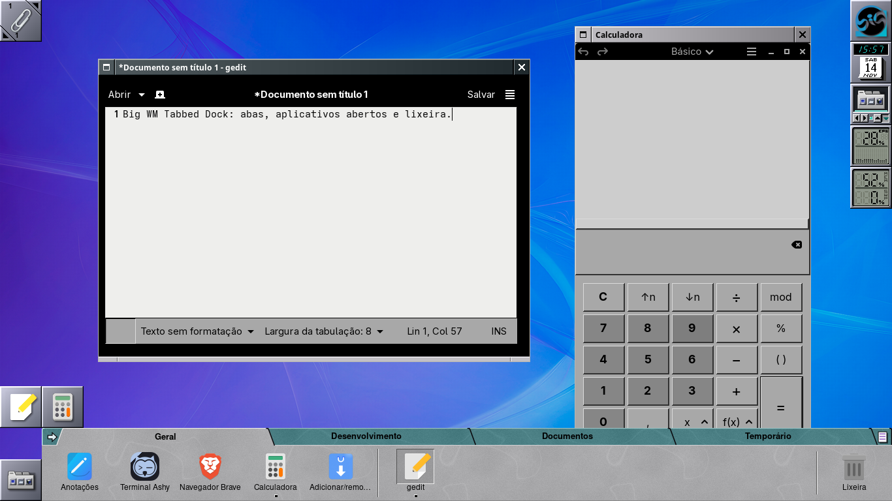
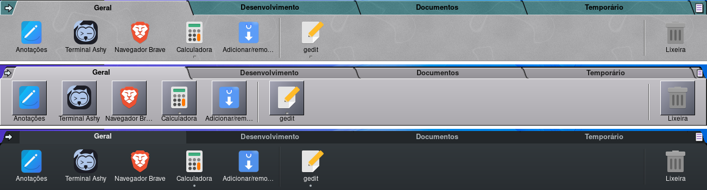
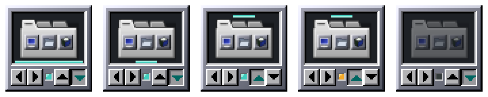
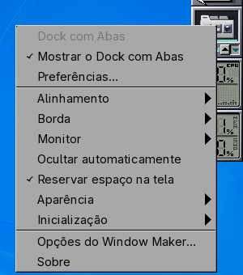
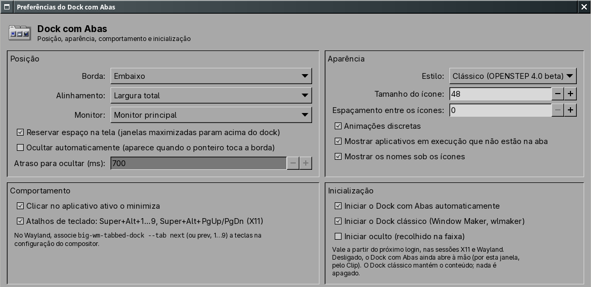
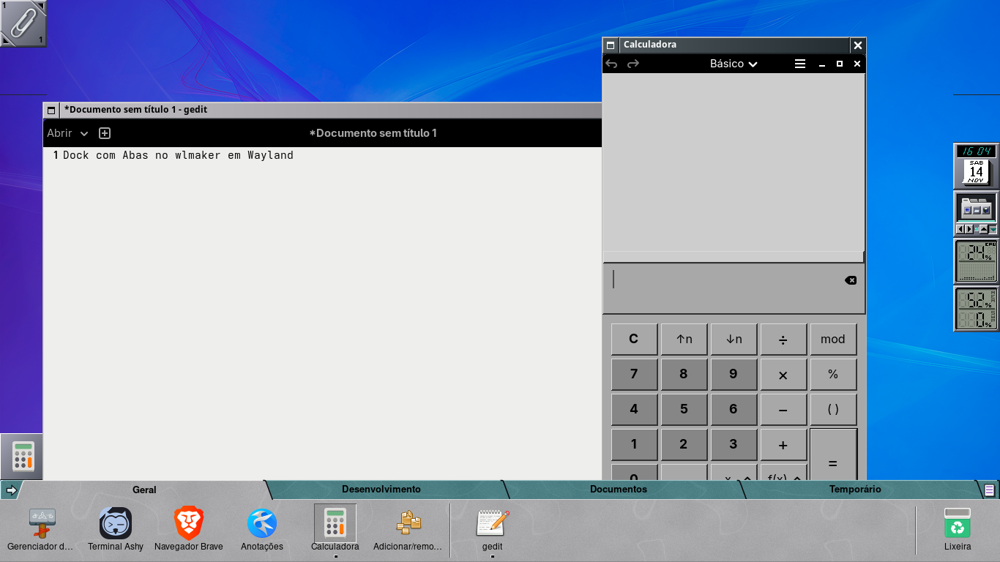

<p align="center">
  
</p>

<h1 align="center">Big WM Tabbed Dock</h1>

<p align="center">
  Dock horizontal com abas para o <b>Window Maker</b> (X11) e o <b>wlmaker</b> (Wayland),
  inspirado na prateleira do OPENSTEP 4.0 beta, e o seu controlador, um dockapp clássico no Dock.
  <br>Parte do <a href="https://github.com/big-windowmaker">Big WindowMaker</a>.
</p>

<p align="center">
  <a href="https://github.com/big-windowmaker/tabbed-dock/actions/workflows/ci.yml"></a>
  
  
  
</p>

<p align="center">
  
  <br><sub>Window Maker (X11): o dock de ponta a ponta na borda inferior, o gedit e a Calculadora abertos
  (o “pino” sob o ícone), a lixeira à direita e o controlador no Dock, entre o relógio e o monitor de CPU.</sub>
</p>

## Sumário

- [O que tem aqui](#o-que-tem-aqui)
- [Recursos](#recursos)
- [Estilos](#estilos)
- [O controlador no Dock](#o-controlador-no-dock)
- [Preferências](#preferências)
- [X11 e Wayland](#x11-e-wayland)
- [Linha de comando](#linha-de-comando)
- [Configuração](#configuração)
- [Compilar e testar](#compilar-e-testar)
- [Pacote](#pacote)
- [Documentação](#documentação)
- [História, créditos e licença](#história-créditos-e-licença)

## O que tem aqui

| Programa | O que faz |
|---|---|
| `big-wm-tabbed-dock` | O dock: abas (Geral, Desenvolvimento, Documentos, Temporário e as suas), aplicativos, pastas e arquivos, aplicativos abertos e lixeira. No X11 é uma janela EWMH do tipo DOCK; no Wayland, uma superfície layer-shell. Inclui a janela de Preferências. |
| `big-wm-tabbed-dock-dockapp` | O **controlador**: um ladrilho de 64 px no Dock do Window Maker (e, pelo XWayland, no do wlmaker), com botões no estilo OPENSTEP. |
| `big-wm-appicons` | Os appicons do Window Maker na sessão Wayland (uma fileira no canto inferior esquerdo, uma por aplicativo aberto). No X11 sai na hora: lá quem desenha os appicons é o próprio Window Maker. |

## Recursos

- **Abas**: Geral, Desenvolvimento, Documentos e Temporário, com nomes traduzidos. Dá para criar, renomear,
  excluir (as criadas), reordenar (arrastando a aba ou pelo menu) e restaurar o padrão; não há limite de quatro.
- **Itens**: atalhos de aplicativos (`.desktop`, inclusive Flatpak e AppImage registrados), AppImages soltos,
  documentos, pastas e separadores, com ícone e rótulo próprios por item.
- **Aplicativos abertos**: um “pino” sob o ícone para cada janela (até três), ladrilho destacado para o
  aplicativo ativo e, à direita, os aplicativos abertos que não estão na aba (arraste um deles para fixá-lo).
- **Clique**: abre; com o aplicativo aberto, ativa a janela; outro clique minimiza (configurável); com várias
  janelas, alterna entre elas. Botão do meio ou Shift+clique abrem outra instância. A rolagem sobre um
  aplicativo alterna as janelas e, sobre o resto, troca de aba.
- **Arrastar**: itens entre abas (move; com Ctrl, copia), reordenar, fixar um aplicativo aberto, soltar
  arquivos e pastas do gerenciador de arquivos (só no X11). Um arquivo solto sobre um aplicativo abre com ele.
  **Tirar um atalho nunca apaga o arquivo.**
- **Lixeira** pelo GIO: com o gvfs, conta a lixeira de todos os volumes montados; sem ele, a da pasta pessoal.
- **Posição**: de ponta a ponta (padrão) ou centro, esquerda ou direita; borda inferior ou superior; monitor
  principal, um monitor pelo nome ou índice, ou todos (espelhado ou cada um com as suas janelas); reserva de
  espaço e ocultação automática opcionais.
- **Coexistência com o Dock clássico**: só o Dock com Abas, só o Dock clássico, os dois ou nenhum, sem tocar
  no conteúdo do Dock clássico.
- **Sistema live**: “Instalar o sistema no HD” entra como primeiro ícone da aba Geral
  ([detalhes](docs/uso-e-configuracao.md#sistema-live-instalar-o-sistema-no-hd)).
- **Temas e idioma**: acompanha o tema claro e escuro do Big WindowMaker; interface traduzida para pt_BR
  (gettext).

## Estilos

<p align="center">
  
  <br><sub>De cima para baixo: <b>Clássico</b> (padrão: a prateleira do OPENSTEP 4.0 beta, com abas
  trapezoidais e corpo de mármore), <b>Ladrilhos do Window Maker</b> e <b>Moderno</b> (plano e escuro).
  Mesma aba, mesmos itens, só <code>Style=</code> trocado.</sub>
</p>

## O controlador no Dock

Um painel de instrumentos OPENSTEP de 64×64 px: o ícone do dock num visor escuro, com a prateleira em
miniatura na borda e no alinhamento atuais, e embaixo `[◀][▶] ● [▲][▼]`.

<p align="center">
  
  <br><sub>Ampliado 3×, da esquerda para a direita: embaixo e de ponta a ponta; embaixo e no centro;
  em cima e no centro (▲ afundado); oculto (lâmpada âmbar); parado (lâmpada apagada e visor escurecido).</sub>
</p>

| Ação | O que acontece |
|---|---|
| **◀ ▶** (ou a roda do mouse) | trocam o alinhamento: Largura total → Direita → Centro → Esquerda |
| **▲ ▼** | trocam a borda; a borda atual fica afundada |
| **●** | lâmpada: acesa com o dock rodando, âmbar se oculto, apagada se parado |
| Clique duplo no ícone | abre as Preferências (uma janela só) |
| Botão direito | o menu ao lado |



O menu traz Mostrar/ocultar, Preferências, Alinhamento, Borda, Monitor, Ocultar automaticamente, Reservar
espaço na tela, Aparência, Inicialização (iniciar, parar, reiniciar; docks da próxima sessão), as opções do
Window Maker e Sobre.

O controlador fala com o dock pelas ações dele no D-Bus: o que muda no controlador aparece nas Preferências,
e vice-versa. Com o dock parado, ele edita a configuração.

No **wlmaker**, o ladrilho chega pelo XWayland; o botão direito na borda do ladrilho abre o menu do próprio
wlmaker, com as mesmas opções (arquivo `Dockapps.d` instalado em `/usr/share/wlmaker/Dockapps.d/`).

<br clear="right">

## Preferências

<p align="center">
  
  <br><sub>Preferências do Dock com Abas: Posição, Aparência, Comportamento e Inicialização. Embaixo
  (fora do recorte) ficam Importar…, Exportar…, Redefinir e Fechar.</sub>
</p>

Abra pelo clique duplo no controlador, por `big-wm-tabbed-dock --preferences` ou por “Preferências do Dock
com Abas” no menu de aplicativos. As escolhas de Inicialização valem a partir do próximo login.

## X11 e Wayland

<p align="center">
  
  <br><sub>wlmaker (Wayland): o mesmo dock como superfície layer-shell, o appicon da Calculadora
  (<code>big-wm-appicons</code>) no canto inferior esquerdo e, à direita, o controlador e os dockapps pelo
  XWayland.</sub>
</p>

O dock é o mesmo nas duas sessões, mas o que o compositor oferece muda o comportamento:

| Recurso | X11 (Window Maker) | Wayland (wlmaker do Big WindowMaker) |
|---|---|---|
| Janela do dock | tipo DOCK, sem foco, em todas as áreas de trabalho | superfície `zwlr_layer_shell_v1` (camada TOP) |
| Aplicativos abertos | `_NET_CLIENT_LIST`, WM_CLASS, `_GTK_APPLICATION_ID` | `ext-foreign-toplevel-list`; ativo/minimizado e ações com `wlr-foreign-toplevel` |
| Ativar, minimizar, fechar, alternar | sim | sim com o wlmaker empacotado (patches 0042–0044); sem eles, menu com as janelas e “Nova janela” |
| Vários monitores | nome RandR, índice ou todos; cada dock pode mostrar só as janelas do seu monitor | nome do conector por xdg-output; a posição das janelas não é conhecida, então cada dock mostra todas |
| Arrastar arquivos do gerenciador | sim (XDND) | não: o wlmaker não tem arrastar e soltar entre clientes; use “Adicionar arquivos/pastas” |
| Atalhos de teclado | `Super+Alt+1…9`, `Super+Alt+PgUp/PgDn` capturados pelo dock | ligue `big-wm-tabbed-dock --tab …` a teclas no `Config.plist` do wlmaker |
| Menus de contexto | normais | o dock fecha o menu 1,5 s depois de o ponteiro sair (o wlmaker não fecha popups de camada ao clicar fora) |
| Appicons | do Window Maker | `big-wm-appicons` |
| Controlador | no Dock | no Dock do wlmaker, pelo XWayland |

A tabela completa, com o estado de cada item e os patches propostos ao wlmaker, está em
[docs/x11-wayland.md](docs/x11-wayland.md).

## Linha de comando

```sh
big-wm-tabbed-dock                     # inicia (o autostart já faz isso no login)
big-wm-tabbed-dock --preferences       # abre as Preferências
big-wm-tabbed-dock --tab next          # troca de aba: next, prev, um número (1…) ou o id da aba
big-wm-tabbed-dock --reload            # relê o arquivo de configuração (também: kill -HUP)
big-wm-tabbed-dock --quit              # grava e encerra
big-wm-tabbed-dock --dock-mode=status  # docks da sessão: classic, tabbed, both, none ou status
big-wm-tabbed-dock --print-state       # estado em texto (usado pelos testes)

big-wm-tabbed-dock-dockapp --set alignment=center   # também edge=, style=, monitor=, autohide=, reserve-space=
big-wm-tabbed-dock-dockapp --toggle | --start | --stop | --restart | --preferences
```

Com o dock já rodando, uma segunda chamada repassa as opções ao dock em execução (GApplication).

## Configuração

`~/.config/big-tabbed-dock/dock.conf` (respeita `XDG_CONFIG_HOME`), com gravação atômica e cópia `.bak` do
último arquivo bom. Dock, Preferências e controlador usam as mesmas chaves:

| Chave | Valores | Padrão |
|---|---|---|
| `Position` | `bottom`, `top` | `bottom` |
| `Alignment` | `fill`, `center`, `left`, `right` | `fill` |
| `Monitor` | `primary`, nome (`HDMI-A-1`…), índice, `all`, `all-independent` | `primary` |
| `IconSize` | 24 a 96 | 48 |
| `Style` | `classic`, `tiles`, `modern` | `classic` |
| `AutoHide`, `ReserveSpace`, `Animations`, `ShowRunning`, `ClickMinimizes`, `ShowLabels` | `true`, `false` | ver o arquivo |
| `GlobalShortcuts` | `true`, `false` (só X11) | `true` |

Um arquivo ilegível vira `dock.conf.broken-<data>` e o `.bak` é usado. Exemplo completo, recuperação e como
reverter tudo à mão: [docs/uso-e-configuracao.md](docs/uso-e-configuracao.md).

## Compilar e testar

```sh
meson setup build
meson compile -C build
meson test -C build --print-errorlogs
sudo meson install -C build
```

| Opção do meson | Padrão | Efeito |
|---|---|---|
| `-Dx11=` | `auto` | rastreamento de janelas no X11 (EWMH) |
| `-Dwayland=` | `auto` | gtk-layer-shell e foreign-toplevel |
| `-Ddockapp=` | `true` | o controlador (precisa do X11) |
| `-Ddock=` | `true` | `false` compila só a biblioteca do núcleo e os testes dela |
| `-Dtests=` | `true` | os testes |

Dependências de compilação: GTK 3 ≥ 3.24, GLib ≥ 2.74, librsvg ≥ 2.46, libX11, libXext, cairo, Wayland,
gtk-layer-shell ≥ 0.6, wayland-protocols ≥ 1.36 e gettext.

`meson test` roda 14 conjuntos: o núcleo (`model`, `config`, `desktop`, `coexist`, `launch`, `wmattrs`,
`geometry`), o rastreador de janelas (`windows`), o controlador (`dockapp` e `dockapp-draw`, este por pixels),
a API de controle por D-Bus (`control`), a largura total com os ícones do Window Maker em volta
(`fullwidth`), regras estáticas (`static`) e o encerramento durante o início (`sigterm-startup`). Os de
sessão sobem um Xvfb e um barramento D-Bus próprios e são pulados sem `Xvfb`, `dbus-daemon` ou `python3`.
Os roteiros de sessão completa (X11 e wlmaker) ficam em [`tests/session/`](tests/session/) e estão
descritos em [docs/testes.md](docs/testes.md).

## Pacote

O pacote do Arch/Manjaro, `big-wm-tabbed-dock`, está em [`pkgbuild/PKGBUILD`](pkgbuild/PKGBUILD); o CI
compila, testa, empacota e roda o `namcap` a cada push. Para empacotar a cópia local:

```sh
cd pkgbuild && TABBED_DOCK_SOURCE="git+file://$PWD/.." makepkg -si
```

| Tipo | Pacotes |
|---|---|
| Depende de | glib2, gtk3, gdk-pixbuf2, cairo, pango, librsvg, libx11, libxext, wayland, gtk-layer-shell, hicolor-icon-theme |
| Opcionais | big-wm-session, big-wm-wayland, windowmaker (`wdwrite`, para escolher os docks), wlmaker (menu do controlador), gvfs (lixeira de todos os volumes) |
| Para compilar | git, meson, gettext, wayland-protocols |

Instala o início automático em `/etc/xdg/autostart/` (`OnlyShowIn=WindowMaker;wlmaker;`, nunca em Plasma,
XFCE ou GNOME), o atalho das Preferências, o ícone no hicolor e a tradução. Nenhuma configuração existente é
alterada na instalação.

## Documentação

| Documento | Conteúdo |
|---|---|
| [docs/README.md](docs/README.md) | Visão geral e galeria das capturas dos testes de sessão |
| [docs/uso-e-configuracao.md](docs/uso-e-configuracao.md) | Instalar, configurar, linha de comando, coexistência, reverter |
| [docs/x11-wayland.md](docs/x11-wayland.md) | Diferenças entre as sessões e o que falta no wlmaker |
| [docs/arquitetura.md](docs/arquitetura.md) | Arquitetura, decisões, segurança e desempenho |
| [docs/testes.md](docs/testes.md) | Como testar e resultados |
| [docs/referencias.md](docs/referencias.md) | Pesquisa histórica sobre a prateleira do OPENSTEP |
| `docs/01-…` a `docs/21-…`, [RELATORIO-FINAL.md](docs/RELATORIO-FINAL.md) | As etapas do controlador e do redesenho dele |
| [CHANGELOG.md](CHANGELOG.md) | Mudanças por versão |

## História, créditos e licença

Desenvolvido dentro do [big-wm](https://github.com/big-windowmaker/big-wm) (diretório `tabbed-dock/`) e
separado em novembro de 2026 com o histórico preservado (`git filter-repo`); ver
[docs/02-migracao-repositorio.md](docs/02-migracao-repositorio.md).

Desenvolvimento: Rafael Ruscher e Barnabé Di Kartola. Agradecimentos e referências em
[CREDITS.md](CREDITS.md).

GPL-2.0-or-later ([LICENSE](LICENSE)).
