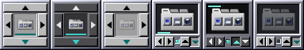

# 16 — Auditoria visual do controlador (antes do redesenho)

Data: 11/11/2026. Ramo `feat/dockapp-redesign-openstep`, a partir de `main`
(`96b9f0f`).

## Como funcionava

- `src/dockapp/btd-dockapp.c`: janela de ícone 64×64 (Xlib), desenhada com
  Cairo num `Pixmap` usado como fundo da janela (sem *flicker*, nada a fazer
  no `Expose`); forma XShape; eventos lidos num filtro do GDK; menu GTK;
  D-Bus (`GDBusActionGroup`) com o dock.
- `src/dockapp/btd-dockapp-state.c`: regiões de clique, estado, textos,
  arquivos do menu do wlmaker — sem X11, testado em `tests/test-dockapp.c`.
- Layout: ↑ (56×12) em cima, ↓ embaixo, ◀ ▶ (12×30) dos lados e um poço
  30×30 com o `tabbed-dock.svg` a **22 px**, renderizado do SVG **a cada
  redesenho**.
- Estado: seta da borda atual na cor de destaque, barra de 2 px no poço
  (alinhamento), ícone a 45 % com o dock parado.

## O que se viu (Window Maker real em Xvfb, dock rodando)

(os três primeiros ladrilhos: claro e escuro rodando, claro parado)

- O ícone, a identidade do projeto, ocupava ~12 % da área; a 22 px a
  prateleira e os três ladrilhos quase não se leem. Parado, some no poço
  cinza.
- Quatro barras de botão grandes dominavam o ladrilho; a seta de estado (↓ em
  destaque) era o único indicador da borda, fácil de não notar.
- Nada distinguia "dock oculto" de "dock rodando".
- Com o build de desenvolvimento (`prefix=/usr/local`) o SVG nem aparece
  (`BTD_DATADIR` aponta para onde ele não está instalado); o pacote
  (`/usr`) acha o ícone em `hicolor`. Não é defeito do produto; nos testes
  use `BTD_DOCKAPP_ICON_FILE`.

## Testes de partida

`meson test -C build`: 12/12 conjuntos OK (dockapp 8 subtestes).

## Arquivos a mudar

Desenho e geometria só: `btd-dockapp.c` (desenho sai para um módulo
próprio), `btd-dockapp-state.c`/`.h` (regiões, forma), novo
`btd-dockapp-draw.c`/`.h`, `src/meson.build`, testes. Nada no dock, no
protocolo D-Bus, nas Preferências nem na configuração.
