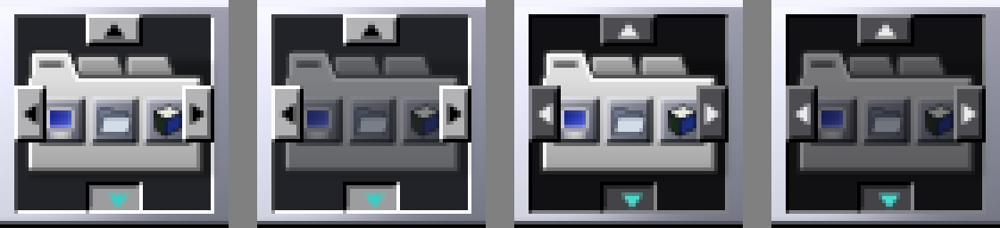
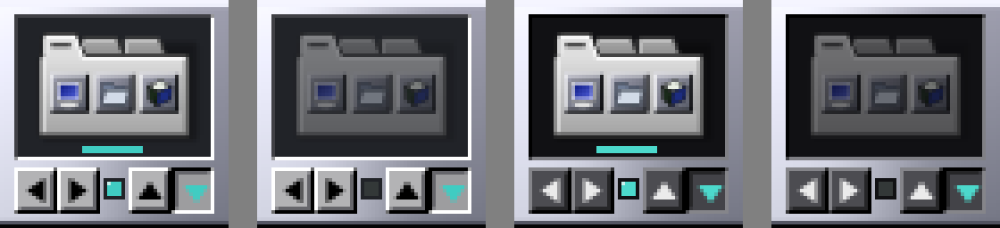
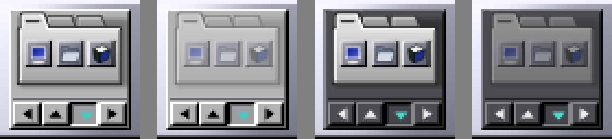

# 17 — Propostas de redesenho

## Referências

[YAWMPPP](https://www.dockapps.net/yawmppp) e
[WMXRES](https://www.dockapps.net/wmxres) (capturas em 64×64, vistas a 4×):

- um **visor escuro afundado** ocupa a maior parte do ladrilho; no WMXRES ele
  mostra uma figura (o monitor), protagonista;
- embaixo, uma **fileira de botões pequenos** (~12 px) em relevo, agrupados
  aos pares e colados (um botão por função, a dupla lida como um controle);
- um **indicador luminoso** (o LED do WMXRES) ao lado dos botões;
- linhas de 1 px nítidas, sem antisserrilhado nas molduras.

## Três conceitos, renderizados com o SVG de verdade

Maquetes em Cairo + librsvg sobre o ladrilho real do Window Maker; em cada
imagem: claro rodando, claro parado, escuro rodando, escuro parado (4×).

**A — Icon First**: o ícone (52 px) ocupa o ladrilho, abas pequenas de
botão nas bordas.

Descartado: ◀ ▶ cobrem os três ladrilhos da prateleira (o que mais
identifica o ícone); abas de 9 px são alvos ruins.

**B — Painel retrô**: visor escuro com o ícone (44 px) e a prateleira em
miniatura; embaixo `[◀][▶] ● [▲][▼]`.

**C — Integrado**: ícone (50 px) sobre a face metálica, botões na "borda
da frente" da prateleira.

No tema claro a prateleira cinza some na face cinza; sem lugar para o
indicador de alinhamento.

## Escolha: B

Em 1× (o que importa) é o único que se lê bem nos dois temas: o cinza claro
da prateleira sobre o visor escuro tem contraste alto nos dois, como o
monitor do WMXRES. O ícone fica com o dobro da largura de antes (22 → 44 px,
~4× a área). Os indicadores têm função: a prateleira em miniatura mostra
borda e alinhamento como na tela; a lâmpada, se o dock roda; a borda atual é
um botão de estado afundado, o idioma do OPENSTEP para "ligado". Os
botões (12×13) têm o tamanho dos do YAWMPPP e ficam longe do ícone: nenhum
conflito de clique.
