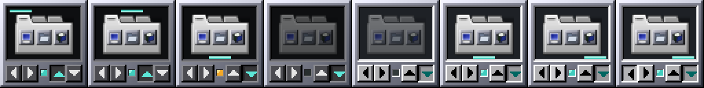
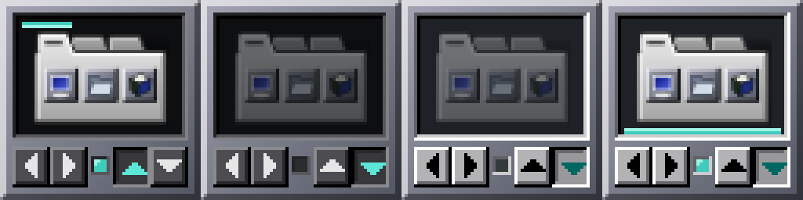

# 19 — Testes do redesenho

## Automáticos (`meson test -C build`)

13/13 conjuntos OK (eram 12). Novo **dockapp-draw** (8 subtestes, sem X11,
em superfícies de imagem):

| Subteste | Verifica |
|---|---|
| icon | o SVG rende uma vez, ≥ 40×28 px de desenho, dentro do visor, fora das faixas da prateleira |
| shape | em todos os estados, nada é desenhado fora da forma XShape; partes da forma sem sobreposição; a lâmpada não é controle |
| feedback-matches-regions | *hover* e botão apertado mudam **só** pixels do retângulo de clique do próprio botão (claro e escuro) |
| latched-edge | o botão da borda atual afundado, o outro em relevo |
| shelf-bar | a prateleira na borda e no alinhamento certos; some com o dock parado |
| lamp-and-dimming | lâmpada acesa / âmbar (oculto) / apagada; visor escurece parado |
| contrast | setas × face > 0,45 de luminância; seta de destaque × face afundada > 0,2; prateleira × visor > 0,4 — nos dois temas |
| redraw-complete | um estado desenhado sobre outro = desenhado do zero (sem resíduo) |

`dockapp` (regiões) atualizado para o layout novo: cada região dentro da
margem de 4 px, botões ≥ 12 px, sem sobreposição, vão e lâmpada sem ação.

ASan + UBSan (build à parte): `dockapp-draw` OK sem vazamentos. `dockapp`
acusa 13 vazamentos **pré-existentes** e idênticos no `main` (GVariant
flutuante rejeitado em `test_apply_to_prefs`/`test_persistence` — só no
teste; fora do escopo).

## Funcionais, Window Maker real (X11)

Xvfb 1024×700, `wmaker` com a configuração do Big WindowMaker (HOME
descartável, barramento próprio, systemctl/logind bloqueados), dock
`big-wm-tabbed-dock` rodando, controlador adotado no Dock em (960,128);
`xdotool`; estado lido pelo D-Bus (`org.gtk.Actions.Describe`).
Script: 18 verificações, **18/18 no tema claro e 18/18 no escuro**:
▶ ×2, ◀ ×3 (ciclo fill → right → center → left), ▲, ▲ de novo, ▼; dois
cliques rápidos em ▶ = dois passos e nenhuma Preferência; roda ↓ ↑; clique
na lâmpada e no vão sem efeito; botão segurado (captura afundada) e solto;
apertar ▶ e soltar fora dele = nada; clique no visor = aviso com o estado;
botão direito = menu (e Esc fecha); clique duplo = Preferências (fechadas
com `_NET_CLOSE_WINDOW`, dock vivo).

Estados capturados: borda em cima, centro, oculto (âmbar), parado (claro e
escuro), dock reiniciado (estado ressincronizado), *hover*, apertado; troca
de tema sem reiniciar.

Arraste: a pressão é repassada ao Window Maker como antes; com o Dock
travado (configuração do Big WindowMaker) o ladrilho não sai do lugar —
**igual** ao binário instalado (antigo), mesmo teste.

ASan + UBSan no Window Maker real: 30 rodadas de *hover*, cliques, roda,
troca de tema e de visibilidade — 0 erros.

## Funcionais, wlmaker (Wayland, pelo XWayland)

wlmaker aninhado (1280×900, XWayland), adotado no Dock do wlmaker em
(1216,195); ponteiro virtual do compositor (`wl-pointer.py` do big-wm).
**10/10**: ▶ ◀ ▲ ▼, roda, lâmpada/vão, botão segurado; clique duplo (dois
cliques no mesmo processo, 80 ms) abre as Preferências; menu do botão
direito; temas e estados iguais ao X11.

## Não testado

Sessão real (login), escala fracionária / HiDPI do XWayland, monitores
físicos; o ladrilho é um bitmap de 64×64 do X11 nos dois casos, a escala é
a do servidor/compositor, como antes.
