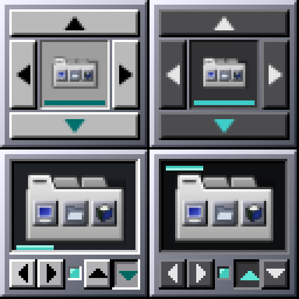

# 21 — Relatório final: redesenho do controlador

Em cima, antes (claro, escuro); embaixo, depois (alinhamento à esquerda
embaixo no claro; à esquerda em cima no escuro). Window Maker real, 4×.

1. **Conceito**: painel de instrumentos OPENSTEP — visor escuro afundado
   com o `tabbed-dock.svg` a 44 px e a prateleira em miniatura; embaixo
   `[◀][▶] ● [▲][▼]` ([17](17-propostas-redesign-dockapp.md)).
2. **Por quê**: em 1× é o único dos três conceitos legível nos dois temas;
   o ícone ganha ~4× a área; cada indicador tem função; botões fora do
   ícone, sem conflito de clique.
3. **SVG**: inalterado (lê-se bem a 44 px; é também o ícone do aplicativo).
4. **Código**: `btd-dockapp-draw.c/.h` (novos), `btd-dockapp.c`,
   `btd-dockapp-state.c`, `btd-dockapp.h`, `meson.build` (src e tests),
   `tests/test-dockapp.c`, `tests/test-dockapp-draw.c` (novo)
   ([18](18-implementacao-visual-dockapp.md)).
5. **Preservado**: ciclo de alinhamento, borda, clique (estado), clique
   duplo (Preferências), botão direito (menu), roda, arraste repassado ao
   Window Maker, dicas, D-Bus, menu do wlmaker, configuração, traduções,
   64×64 com forma XShape, troca de tema na hora.
6. **Testes**: `meson test` 13/13; funcionais no Window Maker 18/18 (claro)
   e 18/18 (escuro); wlmaker/XWayland 10/10; ASan/UBSan sem erros
   ([19](19-testes-redesign-dockapp.md)).
7. **X11 e Wayland**: verificados em laboratório — Window Maker em Xvfb e
   wlmaker aninhado com XWayland. **Não verificado** na sessão real (login).
8. **Desempenho**: parado 0 CPU; sob uso ~40 % menos CPU; memória igual
   ([20](20-polimento-performance-dockapp.md)).
9. **Capturas**: `docs/screenshots/dockapp-redesign/`.
10. **Pendências**: sessão real e escala HiDPI/fracionária do XWayland não
    testadas; vazamento só de teste em `tests/test-dockapp.c`
    (`test_apply_to_prefs`, `test_persistence`: GVariant flutuante
    rejeitado), pré-existente, fora do escopo; uma nova versão do pacote
    `big-wm-tabbed-dock` é necessária para chegar aos usuários.
